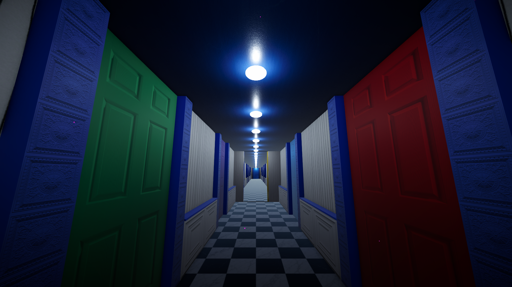
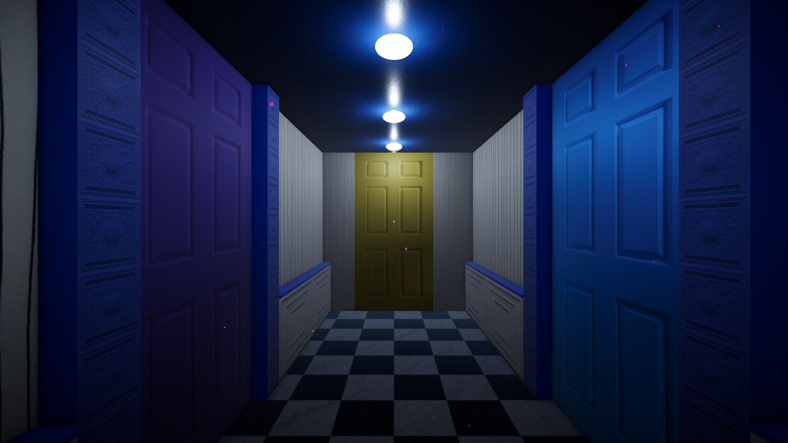
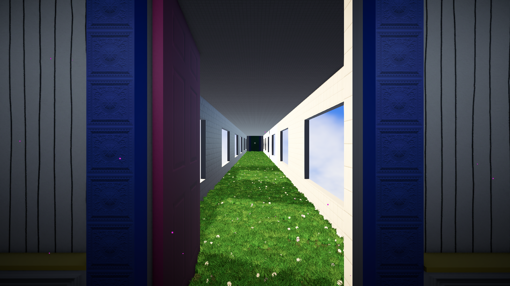
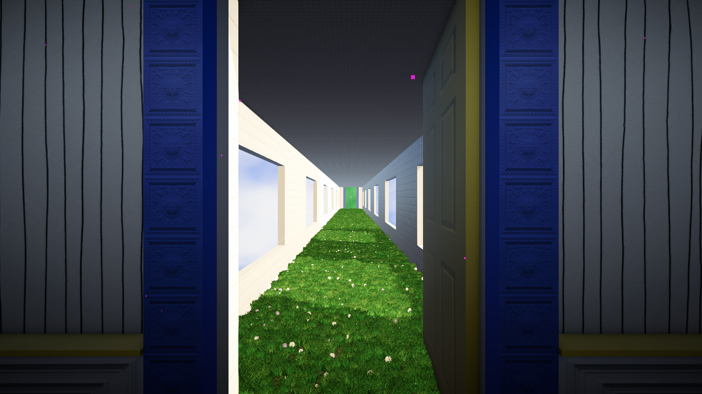
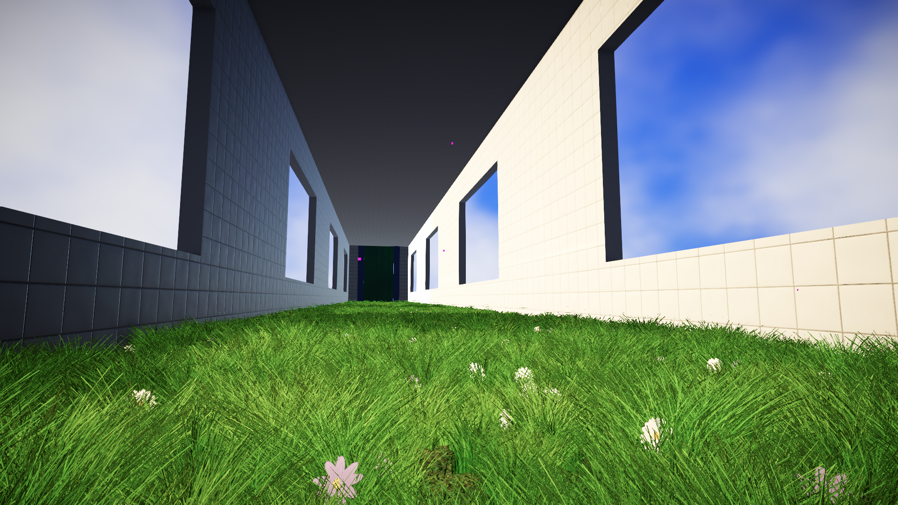
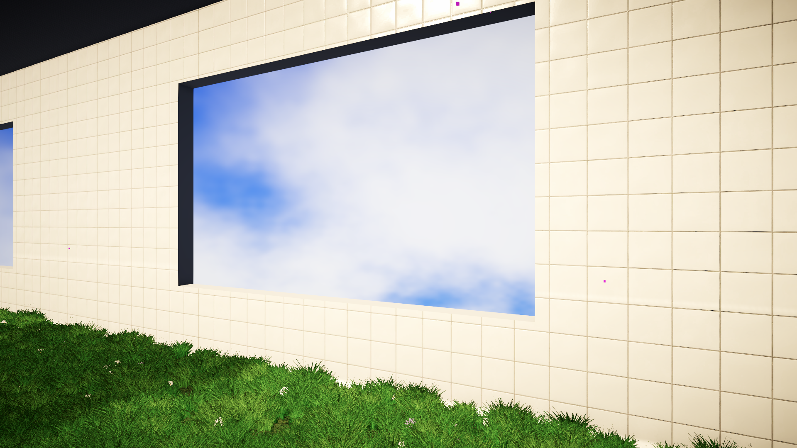
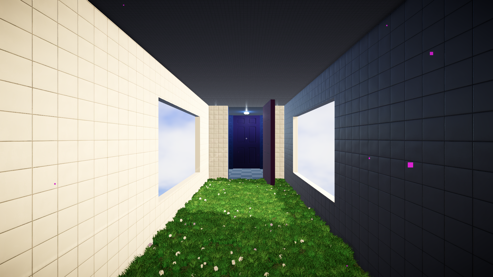
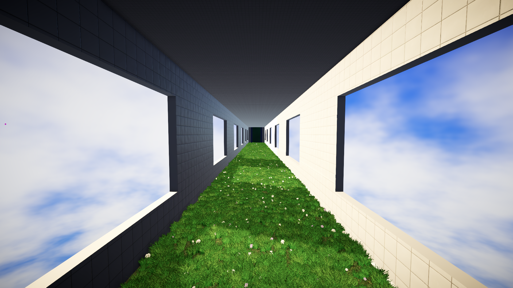
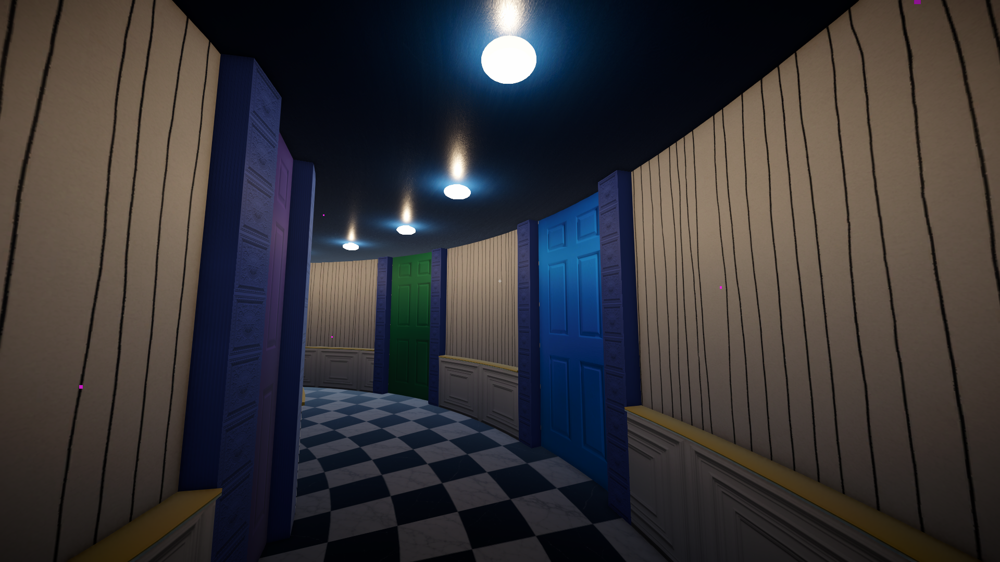
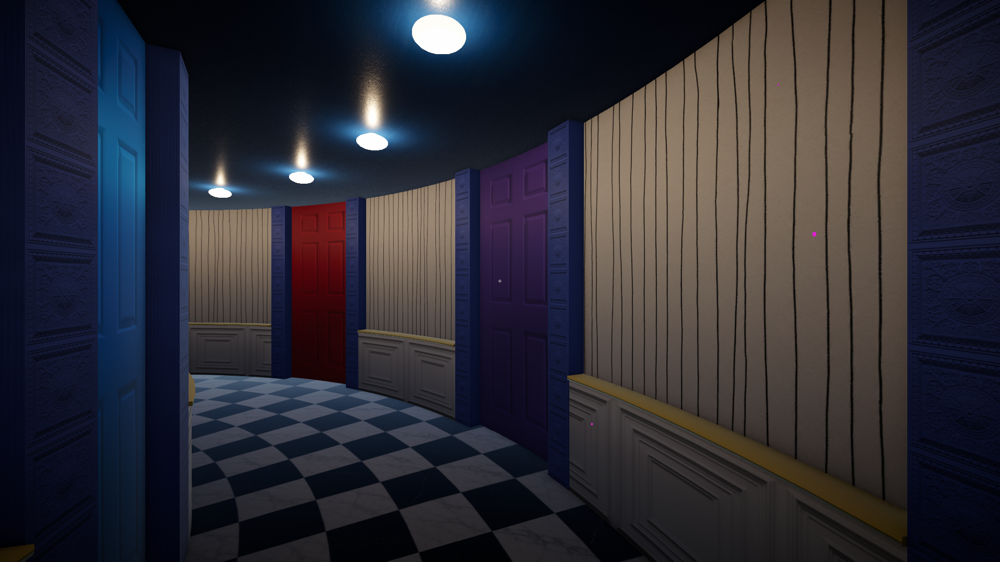

<div align="center">

# WonderDoor

**A surreal first-person walk through giant corridors of coloured doors, a circular arc hall and a sunlit meadow room, built in Unity 6 + URP.**

*Сюрреалистичные коридоры с цветными дверями, круглый зал и комната-луг с солнечными окнами.*


</div>

## About

WonderDoor is a Unity 6 lab scene for my junior portfolio. With a liminal-space mood,
the player walks through oversized rooms built from a **prefab and prefab-variant hierarchy**:

- **Room 1:** a long checkerboard corridor lined with tall coloured doors and cool blue-white ceiling lamps. The pink and yellow doors open onto the meadow wings.
- **Arc corridor:** a circular hall with red, green, blue and violet doors, warm ceiling lamps and a spline-extruded floor.
- **Room 2 (two wings):** a meadow corridor with procedurally generated grass and flowers, lit by sunlight through sky windows.

## Features

- **First-person controller** (`CharacterController`): walk, run, jump, mouse look, and a crosshair with an interaction hint.
- **Interactable doors** (`E`): `InteractableDoor` finds the hinge edge from the collider and swings the door open or closed around it.
- **Procedural meadow** (`MeadowField`): grass tufts and flowers are generated as a mesh on top of the floor at runtime and in the editor (`[ExecuteAlways]`), and are never saved into the scene.
- **Window sunlight** (`WindowSunlight`): a directional "sun" placed from the room bounds, angled through the windows and limited by **rendering layer**, so only room 2 and its grass receive it.
- **Atmosphere** (`Atmosphere`): exponential fog, ACES tonemapping, bloom, vignette, colour adjustments, film grain and drifting dust, all set up from code at runtime.
- **Arc floor UVs** (`ArcFloorUVLive`): rebuilds the spline-extruded floor UVs live so the tiles follow the curve.
- **Editor helpers**: `EnsureSinglePlayer` keeps exactly one Player at the corridor spawn, plus scene-picking unlock and UV tools under **WonderDoor/**.
- **C# CodeLab**: small demos of `Dictionary` vs `HashSet`, `string` vs `StringBuilder`, and `struct` vs `class` semantics.

## Screenshots

### Room 1: cool lamps and giant doors
| | |
|:---:|:---:|
|  |  |
| Wide view of the checkerboard corridor under cool ceiling lamps | The spawn point, facing the yellow door |

### Door transitions: from the corridor into the light
| | |
|:---:|:---:|
|  |  |
| `E` opens the pink door onto the sunlit meadow | Behind the far yellow door is a second meadow wing |

### Room 2: the sunlit meadow
| | |
|:---:|:---:|
|  |  |
| Procedural grass tufts and flowers at ground level | Sky windows and warm window sunlight |
|  |  |
| Looking back at the open door into the dark corridor | Wide view of the meadow |

### Arc hall: warm lamps and coloured doors
| | |
|:---:|:---:|
|  |  |
| The circular hall under warm ceiling lamps | Red, green, blue and violet doors along the curve |

<sub>All shots were captured in a Windows player build at 1920×1080 with the project's own lighting. Only the camera position and FOV were changed.</sub>

## Controls

| Input | Action |
|-------|--------|
| `W` `A` `S` `D` | Move |
| `Shift` | Run |
| `Space` | Jump |
| Mouse | Look |
| `E` | Open / close the door under the crosshair |
| `Esc` / left mouse button | Unlock / lock the cursor |

## Tech highlights

- **Prefab architecture.** `_Base` pieces (floor, ceiling, walls, doors, windows) feed `_Frame` room frames (`frame_room1`, `frame_room2_start/end`), which feed `_Variants` and the room prefabs (`room1`, `room2`, `Arc_Corridor`).
- **Rendering layers** keep the sunlight local to one room without extra cameras or light cookies.
- **Runtime-generated content** (meadow mesh, post-processing volume, dust) keeps the scene file light.
- **Auto colliders** (`AutoMeshCollider`, `AutoCollidersInChildren`) add colliders to imported meshes.

## Project structure

```
WonderDoor/                     Unity project
  Assets/_Project/
    Art/                        Materials, Models, Shaders, Textures (incl. HDRI, meadow atlas)
    Prefabs/_Base, _Frame, _Variants, room
    Scenes/01_WonderDoor.unity  main scene
    Scripts/Gameplay/           PlayerController, InteractableDoor, Atmosphere, WindowSunlight, ...
    Scripts/Editor/             EnsureSinglePlayer, ArcFloorUV, UnlockScenePicking
    Scripts/CodeLab/            C# fundamentals demos
docs/                           reference images and screenshots
```

## Getting started

1. Install **Unity 6000.6.4f1** (Unity 6).
2. Clone the repo, then in Unity Hub choose **Add → Add project from disk** and pick the **`WonderDoor/`** subfolder.
3. Open `Assets/_Project/Scenes/01_WonderDoor.unity` and press **Play**.
